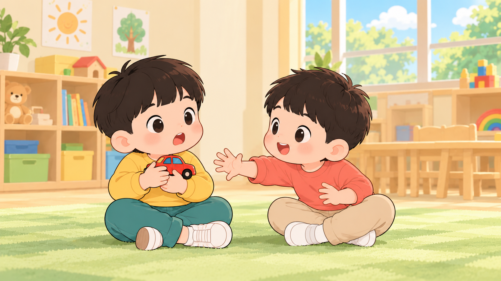

# A02

Correct dialogue at approximately 0–3.84 s, followed by extra unintelligible speech-like content at 3.84–8.6 s. The requested 5.8–10 s silence is not respected.

ASR-derived observations; timestamps are approximate. Unintelligible ASR text is not an authoritative transcript. Human listening is still needed to assess noise, overlap, and voice quality.

## Inputs

[Exact prompt](prompt.txt) · [Request](request.json) · [Generated output](output.mp4)

| First frame | Last frame |
|---|---|
|  |  |

## Expected dialogue

主角：不可以抢哦。这个是我先玩的。

## Automatic transcript

不可以抢哦,这个是我先玩的冰可莱,荣西,不顾,亮丽和我这对乎的笨

## Baseline

[Original prompt](baseline/prompt.txt) · [Original output](baseline/output.mp4)

不可以抢哦,这个是我先玩的林可败,不荣西,不,亮一,我这得自不略拜你

The baseline uses the same frame bytes, seed, duration, steps, resolution and server configuration. The simplified prompt changes several instructions together, including removal of music; this is not a single-variable ablation.
